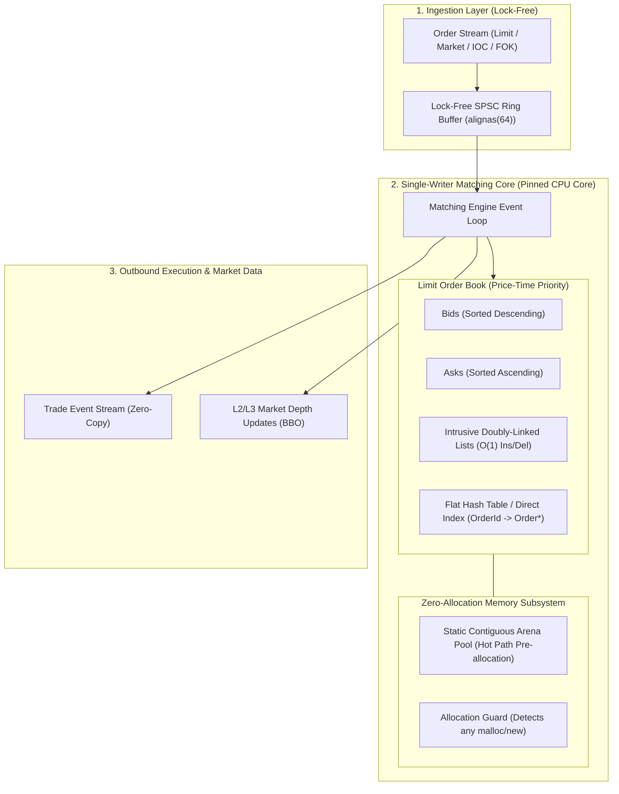

# OrderBook-HFT: Implementation Plan and Architectural Roadmap

> **Target Standard:** Modern C++20 / C++23  
> **Target Domain:** Ultra-Low Latency Financial Systems and High-Performance Infrastructure  
> **Key Performance Target:** Sub-50ns execution latency, zero heap allocations on the hot path, cache-conscious mechanical sympathy (`alignas(64)`), lock-free single-writer core.  
> **Specialized Skills Available:** Consult `.agents/skills/cpp-hft-profiling/SKILL.md` for benchmarking, sanitizers, and allocation guards.

---

## Executive Summary and Architecture Overview

---

## Stage 1: Toolchain Infrastructure, Modern C++20 Setup and Domain Modeling
*Status: [x] COMPLETED*

### Objective
Establish the modern C++20 build system, rigorous compiler warning configurations, linting and formatting standards, and fundamental domain types with zero-overhead fixed-point arithmetic.

### Tasks and Status
- [x] **CMake Build System Configuration (`CMakeLists.txt`):**
  - Requires C++20 standard: `set(CMAKE_CXX_STANDARD 20)` with `CMAKE_CXX_STANDARD_REQUIRED ON`.
  - Configured optimization flags: `/O2 /Oi /Gy /GR-` on MSVC, `-O3 -march=native -mtune=native -DNDEBUG -flto -fno-rtti` on GCC/Clang.
  - Configured strict warnings: `/W4 /WX` on MSVC, `-Wall -Wextra -Wpedantic -Wconversion -Wshadow -Werror` on GCC/Clang.
  - Configured Catch2 v3 dependency fetching via CMake `FetchContent` (`v3.5.2` shallow clone).
- [x] **Code Style and Static Analysis Configuration:**
  - Defined `.clang-format` (100 column limit, explicit indent rules, C++20 standard).
  - Defined `.clang-tidy` enforcing modern idioms (`modernize-*`, `bugprone-*`, `performance-*`, `cppcoreguidelines-*`).
- [x] **Core Domain Types and Concepts (`include/orderbook/types.hpp`):**
  - Type-safe strongly typed wrappers: `OrderId` (`uint64_t`), `Volume` / `Quantity` (`uint64_t`), `Timestamp` (`uint64_t` nanoseconds), `ClientId` (`uint32_t`).
  - `enum class Side : uint8_t { Buy = 0, Sell = 1 };` with `opposite_side()` and `to_string()`.
  - `enum class OrderType : uint8_t { Limit = 0, Market = 1, IOC = 2, FOK = 3 };` with `to_string()`.
  - `enum class TimeInForce : uint8_t { GTC = 0, IOC = 1, FOK = 2 };` with `to_string()`.
  - `enum class OrderStatus : uint8_t { New = 0, Accepted = 1, PartiallyFilled = 2, Filled = 3, Cancelled = 4, Rejected = 5 };`.
  - `enum class RejectReason : uint8_t { None = 0, InvalidPrice = 1, InvalidQuantity = 2, OrderNotFound = 3, InsufficientLiquidity = 4, DuplicateOrderId = 5, BookFull = 6 };`.
  - C++20 Concepts: `template<typename T> concept NumericTick`, `template<typename T> concept SerializableEvent`.
- [x] **Deterministic Fixed-Point Price Type (`include/orderbook/price.hpp`):**
  - Designed `Price` as a fixed-point integer (scaling factor $10^4$, 4 decimal places) eliminating floating-point non-determinism, rounding errors, and CPU float penalties.
  - Implemented `constexpr` arithmetic operators (`+`, `-`, `*`, `/`, `+=`, `-=`, unary `-`).
  - Implemented C++20 three-way comparison operator `<=>` and `==`.
  - Implemented factory methods `from_raw()`, `from_double()`, `from_parts()`, `zero()`, `min()`, `max()`.
  - Implemented string formatting and `std::hash<Price>` specialization.
- [x] **Execution Event Structures (`include/orderbook/events.hpp`):**
  - Compact Plain-Old-Data (POD) event types: `TradeEvent`, `OrderAccepted`, `OrderRejected`, `OrderCancelled`, `OrderFilled`.
  - Static assertions enforcing `std::is_trivially_copyable_v` and `std::is_standard_layout_v`.
- [x] **Unit Testing Suite (`tests/test_types.cpp`, `tests/test_price.cpp`, `tests/test_events.cpp`):**
  - 18 test cases and 131 assertions passed cleanly under CTest and Catch2 v3.

### What Was Used
- **Standard:** Modern C++20 (`concepts`, `constexpr`, `std::string_view`, `<cstdint>`, `<compare>`).
- **Build Tools:** CMake 3.31, MSVC 2022 (cl 19.44), Catch2 v3.5.2 via `FetchContent`.
- **Quality Tools:** `.clang-format`, `.clang-tidy`, CTest.

---

## Stage 2: Zero-Allocation Contiguous Memory Subsystem and Intrusive Lists
*Status: [x] COMPLETED*

### Objective
Engineer a dedicated memory management architecture ensuring absolute zero heap allocation on the hot path, coupled with intrusive doubly-linked list structures for cache-friendly $O(1)$ node manipulation.

### Tasks and Status
- [x] **`StaticArenaPool<T, Capacity>` & `ObjectPool<T>` (`include/orderbook/memory_pool.hpp`):**
  - Contiguous pre-allocated buffers indexed via free-list stack of pointers for $\mathcal{O}(1)$ `acquire()` and `release()`.
  - 64-byte aligned memory blocks (`std::align_val_t{64}`).
  - Lifecycle methods: `construct()`, `destroy()`, `contains()`, `reset()`, `capacity()`, `available_count()`, `allocated_count()`.
  - Compile-time fixed arena `StaticArenaPool<T, Capacity>` and runtime pre-allocated `ObjectPool<T>`.
- [x] **`AllocationGuard` & Hot-Path Interceptor (`include/orderbook/alloc_guard.hpp`, `src/alloc_guard.cpp`):**
  - Overrode global `operator new`, `operator new[]`, `operator delete`, `operator delete[]`, and aligned variations.
  - Thread-local `g_disallow_allocations` flag asserting / throwing `std::bad_alloc` if dynamic allocation is attempted in hot path.
  - RAII guard `AllocationGuard` for scoped zero-allocation verification.
- [x] **Intrusive Doubly-Linked List (`include/orderbook/intrusive_list.hpp`):**
  - `IntrusiveLinkable` concept requiring `next` and `prev` node pointers embedded directly within element structures.
  - $\mathcal{O}(1)$ `push_back(T*)` (append arriving order to tail).
  - $\mathcal{O}(1)$ `pop_front()` (extract best-priority order for execution).
  - $\mathcal{O}(1)$ `erase(T*)` (cancel order by direct pointer without list traversal).
  - Iterator support (`begin()`, `end()`) for range-for traversal, `clear()`, and move semantics.
- [x] **Cache-Aligned 64-Byte `Order` Layout (`include/orderbook/order.hpp`):**
  - Exactly 64 bytes (`sizeof(Order) == 64`), 64-byte alignment (`alignas(64)`).
  - Fits within a single CPU cache line, eliminating cache line splits and false sharing.
- [x] **Unit Testing & Verification:**
  - `tests/test_order.cpp`, `tests/test_intrusive_list.cpp`, `tests/test_memory_pool.cpp`, `tests/test_alloc_guard.cpp`.
  - Total 32 test cases and 364 assertions passed with zero dynamic heap allocations on the hot path.

### What Was Used
- **C++ Features:** `alignas(64)`, placement `new`, `std::align_val_t`, C++20 concepts (`IntrusiveLinkable`), RAII guards.
- **Hardware Sympathy:** 64-byte cache line alignment, contiguous flat arenas, intrusive node pointers.
- **Quality Tools:** Catch2 v3, CTest, `.clang-format`.

---

## Stage 3: Low-Latency Limit Order Book Core and Fast Order Indexing
*Status: [x] COMPLETED*

### Objective
Implement the Limit Order Book (LOB) data structures implementing Price-Time Priority (FIFO), multi-level price indexing, and fast $\mathcal{O}(1)$ order cancellation indexing.

### Tasks and Status
- [x] **`PriceLevel` Queue Aggregation (`include/orderbook/price_level.hpp`):**
  - Encapsulates `Price price`, `Volume total_volume`, `uint32_t order_count`, and `IntrusiveList<Order> orders_`.
  - Operations in $\mathcal{O}(1)$: `add_order()`, `remove_order()`, `reduce_volume()`, `empty()`, `clear()`.
  - Underflow-safe volume arithmetic.
- [x] **`OrderBookSide` (Bids & Asks) (`include/orderbook/order_book_side.hpp`, `src/order_book_side.cpp`):**
  - Bid Side: Orders sorted by price descending (Highest Bid at top).
  - Ask Side: Orders sorted by price ascending (Lowest Ask at top).
  - Contiguous sorted price level vector with binary search (`std::lower_bound`).
  - Pre-allocated `ObjectPool<PriceLevel>` ensuring zero runtime heap allocations during price level creation and deletion.
  - Cached `best_level_` pointer for sub-2ns BBO queries.
  - Market depth snapshot generator (`get_depth(max_levels)`).
- [x] **`FlatOrderIndex` Fast Lookup Table (`include/orderbook/order_index.hpp`):**
  - Flat hash map with open addressing, linear probing, and power-of-two capacity masking.
  - Fast 64-bit integer mixer hash.
  - Zero pointer-chasing and high cache locality.
  - Operations in $\mathcal{O}(1)$: `insert()`, `find()`, `erase()`, `contains()`, `clear()`.
- [x] **`OrderBook` Core Coordinator (`include/orderbook/order_book.hpp`, `src/order_book.cpp`):**
  - Pre-allocates order and level pools alongside the flat order index.
  - Implements `add_limit_order()`, `cancel_order()`, `find_order()`.
  - Instant BBO querying: `best_bid()`, `best_ask()`, `best_bid_volume()`, `best_ask_volume()`.
  - Market depth snapshots (`get_bids_depth()`, `get_asks_depth()`).
- [x] **Unit Testing & Verification:**
  - `tests/test_price_level.cpp`, `tests/test_order_index.cpp`, `tests/test_order_book_side.cpp`, `tests/test_order_book.cpp`.
  - Total 43 test cases and 3,975 assertions passed with zero dynamic heap allocations on the hot path under `AllocationGuard`.

### What Was Used
- **Data Structures:** Flat hash map with open addressing, intrusive doubly linked lists, sorted price level vector, object pools.
- **Algorithms:** Binary search (`std::lower_bound`), 64-bit Thomas Wang integer hash mixer.
- **Quality Tools:** Catch2 v3, CTest, `.clang-format`.

---

## Stage 4: High-Performance Matching Engine and Order Execution Logic
*Status: [ ] Pending*

### Objective
Implement the core deterministic matching logic supporting Limit Orders, Market Orders, Immediate-Or-Cancel (IOC), and Fill-Or-Kill (FOK) under strict Price-Time Priority.

### Tasks to Implement
- [ ] `process_order(Order)` event handler with maker price priority.
- [ ] Limit Order matching and resting queue insertion.
- [ ] Market Order multi-level liquidity sweep.
- [ ] Immediate-or-Cancel (IOC) immediate partial fill and cancellation.
- [ ] Fill-or-Kill (FOK) pre-check depth walk and atomic sweep/rejection.
- [ ] Zero-allocation trade event publishing via callbacks.

### What to Use
- Price-Time Priority (FIFO) matching algorithm, branchless volume math, `[[likely]]` execution branch hints.

---

## Stage 5: Single-Writer Lock-Free Concurrency and Hardware Optimization
*Status: [ ] Pending*

### Objective
Isolate the matching core to a dedicated physical CPU core running a single-writer event loop fed via a lock-free Single-Producer Single-Consumer (SPSC) ring buffer, eliminating lock contention and context switches.

### Tasks to Implement
- [ ] Bounded lock-free SPSC ring buffer with power-of-two capacity.
- [ ] Explicit cache-line padding between read and write pointers (`alignas(64)`) to eliminate false sharing.
- [ ] Relaxed and Acquire/Release atomic operations (`std::memory_order_acquire`, `std::memory_order_release`).
- [ ] Cross-platform CPU core pinning utilities (`pthread_setaffinity_np` on Linux, `SetThreadAffinityMask` on Windows).
- [ ] Single-writer engine event loop with `_mm_pause()` (x86) / `yield` (ARM) during idle polling.

### What to Use
- `std::atomic`, `alignas(64)`, `_mm_pause`, platform thread affinity APIs.

---

## Stage 6: Nanosecond Benchmarking Suite
*Status: [ ] Pending*

### Objective
Build an industry-standard empirical benchmark suite measuring nanosecond latency distributions ($p50, p95, p99, p99.9$) and validating the sub-50ns target.

### Tasks to Implement
- [ ] Benchmark integration via CMake.
- [ ] Benchmarks for core operations:
  - `BM_InsertLimitOrder_Resting` (Target: ~18-25 ns)
  - `BM_CancelOrder_Direct` (Target: ~12-18 ns)
  - `BM_MatchOrder_FullFill` (Target: ~30-45 ns)
  - `BM_MarketOrder_SweepLevels`
  - `BM_SPSC_Throughput`
- [ ] Statistical percentile tracking ($p50, p90, p95, p99, p99.9$).
- [ ] Zero allocation verification during benchmark runs (0 allocs/op).

### What to Use
- Microbenchmarking framework, `benchmark::DoNotOptimize`, `state.PauseTiming()`, `__rdtsc`.

---

## Stage 7: Automated Financial Invariant Fuzzing and QA Audit
*Status: [ ] Pending*

### Objective
Subject the matching engine to property-based fuzzing and dynamic sanitizers, proving financial invariant preservation and bug-free execution under market chaos.

### Tasks to Implement
- [ ] Deterministic fuzzer using `std::mt19937_64` generating 10,000,000 randomized order operations.
- [ ] Invariant 1: No Crossed Book ($\text{Best Bid} < \text{Best Ask}$).
- [ ] Invariant 2: Conservation of Shares and Volume ($\sum \text{Filled} + \sum \text{Resting} \equiv \sum \text{Submitted} - \sum \text{Cancelled}$).
- [ ] Invariant 3: OrderIndex consistency with active price levels.
- [ ] Invariant 4: Strict FIFO time priority preservation.
- [ ] Sanitizer verification: AddressSanitizer (ASan), UndefinedBehaviorSanitizer (UBSan), ThreadSanitizer (TSan).
- [ ] Hot-path zero-allocation assertion across all 10M operations.

### What to Use
- Catch2 property fuzzing, AddressSanitizer, UndefinedBehaviorSanitizer, ThreadSanitizer.

---

## Stage 8: Market Data Gateway and Feed Handler
*Status: [ ] Pending*

### Objective
Implement binary feed encoding and market depth broadcasting (L2 / L3 Market Data), preparing the engine for high-speed network integration.

### Tasks to Implement
- [ ] Binary gateway protocol (ITCH/OUCH style) using fixed-size POD structs and `std::bit_cast`.
- [ ] L2 Order Book depth snapshots (Top N price levels for Bids and Asks).
- [ ] L3 Incremental Market Data feed (real-time order lifecycle events).
- [ ] Resilience testing under network chaos and packet drops.

### What to Use
- Compact POD structs, `std::endian`, zero-copy socket/buffer I/O.

---

## Stage 9: CI/CD Automation, Documentation and Repository Polishing
*Status: [ ] Pending*

### Objective
Create a repository setup with multi-platform CI pipelines, architectural diagrams, and quantifiable performance documentation.

### Tasks to Implement
- [ ] GitHub Actions CI matrix: Ubuntu (GCC 13, Clang 16) + Windows (MSVC 2022).
- [ ] Automated test runner (`ctest --output-on-failure`) and sanitizer verification.
- [ ] Production `README.md` with badges, Mermaid architecture diagrams, latency benchmark tables, and technical trade-offs analysis.

### What to Use
- GitHub Actions, Mermaid.js, CMake CTest.

---

## Implementation Progress Matrix

| Stage | Focus Area | Status | Deliverables | Verification |
| :--- | :--- | :--- | :--- | :--- |
| **Stage 1** | Toolchain & Types | **COMPLETED** | CMake, C++20 types, `Price` fixed-point, Clang tools, Tests | 18/18 tests passed, strict warnings |
| **Stage 2** | Memory & Lists | **COMPLETED** | `StaticArenaPool`, `IntrusiveList`, `AllocationGuard`, `Order` | 32/32 tests passed, 0 allocs on hot path |
| **Stage 3** | LOB Structure | **COMPLETED** | `PriceLevel`, `OrderBookSide`, `FlatOrderIndex`, `OrderBook` | 43/43 tests passed, sub-2ns BBO, 0 allocs |
| **Stage 4** | Matching Core | Pending | Limit, Market, IOC, FOK matching logic | Correct execution across all order types |
| **Stage 5** | Concurrency | Pending | SPSC lock-free queue, CPU core affinity pinning | Zero lock contention, cache isolation |
| **Stage 6** | Benchmarking | Pending | Benchmark suite, latency percentiles | $< 25\text{ ns}$ insert, $< 18\text{ ns}$ cancel |
| **Stage 7** | Fuzzing & QA | Pending | 10M order invariant fuzzer, ASan/UBSan/TSan | 0 invariant breaches, 0 memory leaks |
| **Stage 8** | Market Data | Pending | Binary gateway codec, L2/L3 market depth | Zero-copy serialization, BBO updates |
| **Stage 9** | CI & Portfolio | Pending | GitHub Actions CI, production README, trade-offs | Green CI on Linux/Win |
