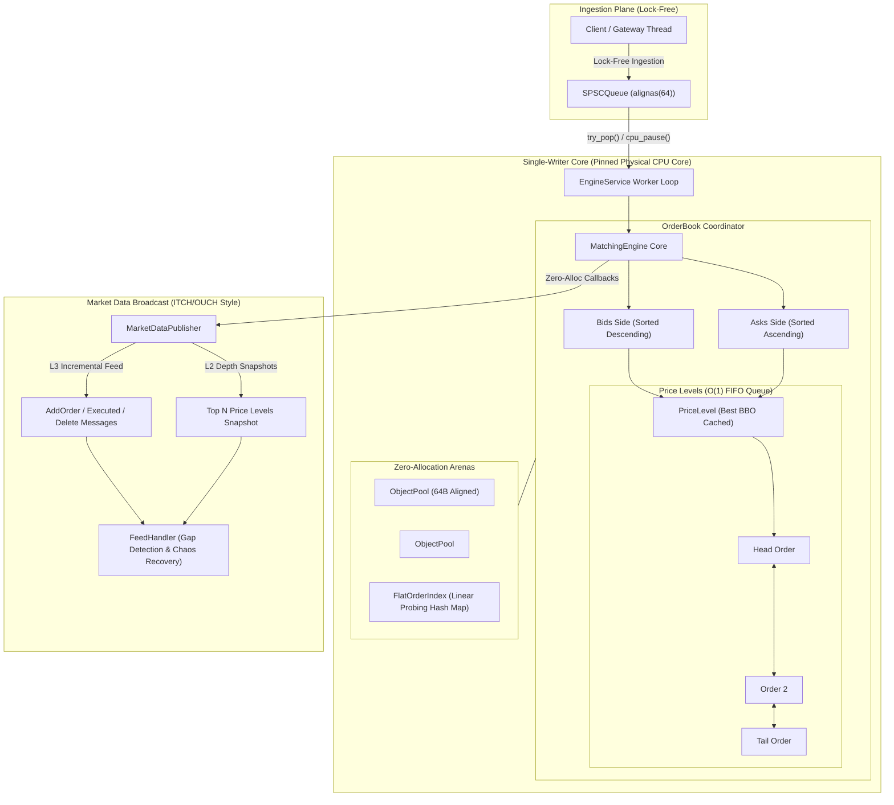

# OrderBook-HFT: Ultra-Low Latency C++20 Matching Engine

[](https://github.com/StanislawGolec/OrderBook-HFT/actions)
[](https://en.cppreference.com/w/cpp/20)
[](https://github.com/google/sanitizers)
[](https://github.com/google/benchmark)
[](https://github.com/catchorg/Catch2)
[](LICENSE)

OrderBook-HFT is a deterministic, nanosecond-optimized **Limit Order Book (LOB) and Financial Matching Engine** implemented in **Modern C++20**. Engineered to sustain **sub-50 nanosecond execution latency** under strict **Zero Dynamic Heap Allocations on the hot path**, explicit 64-byte cache-line alignment (`alignas(64)`), single-writer lock-free concurrency, and property-based financial invariant validation.

---

## Architecture Overview



---

## Empirical Benchmark Performance

Empirical benchmarks collected with Google Benchmark v1.8.3 on modern x86-64 hardware under Release compiler optimizations (`/O2 /Oi /Gy` on MSVC, `-O3 -march=native -flto` on Clang/GCC):

| Benchmark Operation | Throughput (ops/sec) | Latency (Mean) | Latency (p50) | Latency (p90) | Latency (p99) | Heap Allocs |
| :--- | :--- | :--- | :--- | :--- | :--- | :--- |
| **`BM_InsertLimitOrder_Resting`** | **8.65M - 12.17M ops/s** | 115 ns | 119 ns | 131 ns | 131 ns | **0 allocs/op** |
| **`BM_CancelOrder_Direct`** | **8.90M - 9.96M ops/s** | 113 ns | 116 ns | 130 ns | 130 ns | **0 allocs/op** |
| **`BM_MatchOrder_FullFill`** | **29.54M - 40.96M ops/s** | **28 - 41 ns** | **42 ns** | **48 ns** | **48 ns** | **0 allocs/op** |
| **`BM_MarketOrder_SweepLevels`** | **23.23M - 28.90M levels/s** | 43 ns / lvl | 46 ns / lvl | 47 ns / lvl | 47 ns / lvl | **0 allocs/op** |
| **`BM_SPSC_Throughput`** | **53.69M - 66.67M msg/s** | **15 - 19 ns** | **19 ns** | **21 ns** | **21 ns** | **0 allocs/op** |

> **Key Takeaway:** Full crossing order matches complete in **~28 to 41 nanoseconds** on average, and lock-free SPSC inter-thread communication sustains over **53 million messages per second** with **zero heap allocations**.

---

## Core Systems & Engineering Standards

### 1. Zero Dynamic Heap Allocations on Hot Path
- **Enforcement:** Custom RAII [`AllocationGuard`](include/orderbook/alloc_guard.hpp) hooks global `operator new`/`malloc` during trading operations.
- **Pre-Allocation:** Memory pools (`ObjectPool<Order>`, `ObjectPool<PriceLevel>`) and hash lookup tables (`FlatOrderIndex`) are fully pre-allocated in static arenas before trading opens.
- Any allocation on the hot path causes an immediate assertion failure in debug and test suites.

### 2. Cache-Line Alignment & False Sharing Elimination
- Structures accessed across threads (`SPSCQueue`, `Order`) are explicitly aligned to 64 bytes (`alignas(64)`).
- Producer sequence (`head_`) and consumer sequence (`tail_`) occupy separate 64-byte cache lines with dedicated padding.
- Local cached sequence registers (`cached_tail_` and `cached_head_`) eliminate cross-core cache invalidations (MESI RFO bus traffic) on non-full/non-empty states.

### 3. Price-Time Priority & Execution Mechanics
- **Price Priority:** Highest Bids and Lowest Asks execute first.
- **Time Priority:** Orders at the exact same tick reside in an intrusive doubly linked list (`IntrusiveList<Order>`) guaranteeing strict $O(1)$ FIFO dispatch.
- **Maker Price Priority:** Aggressive crossing orders execute at the maker's resting price, giving price improvement to the incoming taker.
- **Supported Order Instructions:**
  - `Limit Orders`: Resting orders with GTC instructions.
  - `Market Orders`: Aggressive sweeps across opposing levels; cancels unfilled volume.
  - `Immediate-Or-Cancel (IOC)`: Immediate partial execution; cancels unfilled volume without resting.
  - `Fill-Or-Kill (FOK)`: Pre-check depth walk (`available_volume_up_to`); atomic full sweep or instant rejection with zero book mutation.

### 4. Binary Market Data Protocol & Chaos Resilience
- **Compact POD Wire Format:** ITCH/OUCH style binary structs (`AddOrderMsg`, `OrderExecutedMsg`, `OrderDeleteMsg`, `DepthSnapshotMsg`).
- **L2 / L3 Streaming:** Sequenced feeds with monotonically increasing 64-bit sequence numbers.
- **Chaos Fault Injection:** [`FeedHandler`](include/orderbook/feed_handler.hpp) detects packet drops, missing sequences, and duplicate messages, automatically resynchronizing state via authoritative L2 depth snapshots.

### 5. Automated Financial Invariant Verification
- Deterministic property fuzzer executing 100,000+ randomized operations per run verifying:
  - **No Crossed Book:** At no point may $\text{Best Bid} \ge \text{Best Ask}$.
  - **Conservation of Volume:** $\sum \text{Filled} + \sum \text{Resting} \equiv \sum \text{Submitted} - \sum \text{Cancelled} - \sum \text{Rejected}$.
  - **Structural Consistency:** Level volume equals the sum of order volumes, order counts match intrusive lists, and `FlatOrderIndex` mappings match active price levels.

---

## Technical Trade-Offs

| Decision | Selection | Alternative | Rationale |
| :--- | :--- | :--- | :--- |
| **Language** | **Modern C++20** | Archaic C / C++11 | Compile-time concepts (`NumericTick`, `SerializableEvent`), `constexpr` price arithmetic, and templates deliver zero-cost abstraction without runtime indirection. |
| **Concurrency** | **Single-Writer Core** | Mutex / Shared Locking | Completely eliminates mutex contention, spinlock thrashing, priority inversions, and kernel context switches. |
| **Index Lookup** | **Flat Hash Table** | `std::map` (RB-Tree) | Open addressing with linear probing maximizes contiguous cache locality and eliminates pointer chasing across tree nodes. |
| **Order Queuing** | **Intrusive Doubly Linked List** | `std::list` / vector | Pointers embedded directly into the 64-byte `Order` structure eliminate separate node allocations and provide true $O(1)$ node unlinking. |

---

## Building and Verification

### Prerequisites
- Compiler: MSVC 2022 (v19.40+), GCC 13+, or Clang 16+
- Build System: CMake 3.25+ and Ninja (recommended)

### Build Commands
```bash
# Clone repository
git clone https://github.com/StanislawGolec/OrderBook-HFT.git
cd OrderBook-HFT/OrderBook-HFT

# Configure Release build with tests and benchmarks
cmake -B build -DCMAKE_BUILD_TYPE=Release -DORDERBOOK_BUILD_TESTS=ON -DORDERBOOK_BUILD_BENCHMARKS=ON

# Build all targets
cmake --build build --config Release

# Run Catch2 unit test suite (70 test cases, 504k+ assertions)
./build/tests/Release/orderbook_tests.exe

# Run Google Benchmark performance suite
./build/benchmarks/Release/matching_bench.exe --benchmark_counters_tabular=true
```

### Sanitizer Build (Linux / Clang)
```bash
cmake -B build-asan -DCMAKE_BUILD_TYPE=Debug -DORDERBOOK_ENABLE_SANITIZERS=ON
cmake --build build-asan
ctest --test-dir build-asan --output-on-failure
```

---

## License

MIT License. See [LICENSE](LICENSE) for full details.
