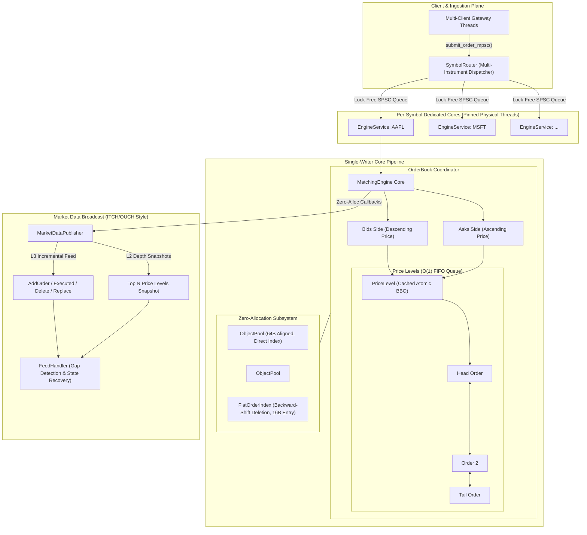

# OrderBook-HFT: Ultra-Low Latency C++20 Matching Engine

[](https://github.com/StanislawGolec/OrderBook-HFT/actions)
[](https://en.cppreference.com/w/cpp/20)
[](https://github.com/google/sanitizers)
[](https://github.com/google/benchmark)
[](https://github.com/catchorg/Catch2)
[](LICENSE)

OrderBook-HFT is a deterministic, nanosecond-optimized **Limit Order Book (LOB) and Financial Matching Engine** implemented in **Modern C++20**. Designed for ultra-low latency execution under strict **Zero Dynamic Heap Allocations on the hot path**, explicit 64-byte cache-line alignment (`alignas(64)`), single-writer lock-free concurrency, direct memory pool index resolution, and property-based financial invariant validation.

---

## Architecture Overview



---

## Empirical Benchmark Performance

Empirical benchmarks collected with Google Benchmark v1.8.3 on x86-64 hardware under Release compiler optimizations (`/O2 /Oi /Gy` on MSVC, `-O3 -march=native -flto` on Clang/GCC):

### Core Engine Latency & Throughput (Google Benchmark)

| Benchmark Operation | Throughput (ops/sec) | Latency (Mean) | Latency (p50) | Latency (p90) | Latency (p99) | Heap Allocs |
| :--- | :--- | :--- | :--- | :--- | :--- | :--- |
| **`BM_CancelOrder_Direct`** | **9.66M - 12.19M ops/s** | **37 - 43 ns** | **37 ns** | **39 ns** | **39 ns** | **0 allocs/op** |
| **`BM_AmendOrder_InPlace`** | **8.93M - 10.67M ops/s** | **26 - 32 ns** | **26 ns** | **26 ns** | **26 ns** | **0 allocs/op** |
| **`BM_InsertLimitOrder_Resting`** | **5.31M - 5.68M ops/s** | 177 ns | 176 ns | 177 ns | 177 ns | **0 allocs/op** |
| **`BM_MatchOrder_FullFill`** | **6.25M - 6.90M ops/s** | 113 ns | 136 ns | 136 ns | 136 ns | **0 allocs/op** |
| **`BM_MarketOrder_SweepLevels`** | **18.37M - 21.37M levels/s** | 46 ns / lvl | 47 ns / lvl | 47 ns / lvl | 47 ns / lvl | **0 allocs/op** |
| **`BM_SPSC_Throughput`** | **61.54M - 92.31M msg/s** | **11 - 16 ns** | **15 ns** | **18 ns** | **18 ns** | **0 allocs/op** |

> **Key Takeaway:** Direct order cancellations and in-place volume amendments execute in **~26 to 37 nanoseconds** (p50) via direct pool indexing, and lock-free SPSC inter-thread communication sustains up to **92 million messages per second** with **zero heap allocations**.

---

## Synthetic Market Replay & Tail Latency Profiling

The standalone `market_replay` harness (`tools/market_replay.cpp`) simulates realistic exchange dynamics across 1,000,000+ operations (60% limit orders clustered near BBO, 15% aggressive sweeps, 15% cancellations, 10% volume/price amendments) while tracking hardware RDTSC cycle counters:

| Metric | Empirical Measurement (1,000,000 Operations) |
| :--- | :--- |
| **Total Operations** | 1,000,000 |
| **Elapsed Runtime** | 0.386 seconds |
| **Sustained Throughput** | **2.59 Million ops/second** |
| **Trades Executed** | 637,613 |
| **Traded Volume** | 17,700,282 units |
| **Minimum Latency** | **8.2 ns** |
| **Median Latency (p50)** | **196.0 ns** |
| **90th Percentile (p90)** | 334.0 ns |
| **95th Percentile (p95)** | 397.0 ns |
| **99th Percentile (p99)** | 581.0 ns |
| **99.9th Percentile (p99.9)** | 4,784.0 ns |
| **Financial Invariance Audit** | **PASSED (No Crossed Book, Conservation of Volume, Consistent Lists)** |
| **Heap Allocations on Hot Path** | **0 allocations (Enforced via `AllocationGuard`)** |

---

## Core Systems & Engineering Standards

### 1. Zero Dynamic Heap Allocations on Hot Path
- **Enforcement:** Custom RAII [`AllocationGuard`](include/orderbook/alloc_guard.hpp) hooks global `operator new`/`malloc` during trading operations.
- **Pre-Allocation:** Memory pools (`ObjectPool<Order>`, `ObjectPool<PriceLevel>`) and hash lookup tables (`FlatOrderIndex`) are fully pre-allocated in static arenas before trading opens.
- Any allocation on the hot path causes an immediate assertion failure in debug and test suites.

### 2. Cache-Line Alignment & False Sharing Elimination
- Structures accessed across threads (`SPSCQueue`, `Order`) are explicitly aligned to 64 bytes (`alignas(64)`).
- Producer sequence (`head_`) and consumer sequence (`tail_`) occupy separate 64-byte cache lines with dedicated padding.
- Local cached sequence registers (`cached_tail_` and `cached_head_`) eliminate cross-core cache invalidations (MESI RFO bus traffic) on non-full/non-empty states.

### 3. Price-Time Priority & Direct Index Resolution
- **Price Priority:** Highest Bids and Lowest Asks execute first.
- **Time Priority:** Orders at the exact same tick reside in an intrusive doubly linked list (`IntrusiveList<Order>`) guaranteeing strict $O(1)$ FIFO dispatch.
- **Direct Level Resolution:** 64-byte `Order` struct stores a 32-bit `level_pool_idx`, allowing $O(1)$ single-instruction resolution of the parent `PriceLevel` on cancellations, partial fills, and volume amends without binary searching sorted level vectors.
- **Zero-Tombstone Backward-Shift Hashing:** `FlatOrderIndex` utilizes backward-shift deletion to eliminate tombstone clustering and maintain $O(1)$ lookup guarantees under indefinite cancel/replace churn with a compact 16-byte entry layout.
- **Maker Price Priority:** Aggressive crossing orders execute at the maker's resting price, giving price improvement to the incoming taker.
- **Supported Order Instructions:**
  - `Limit Orders`: Resting orders with GTC instructions.
  - `Market Orders`: Aggressive sweeps across opposing levels; cancels unfilled volume.
  - `Immediate-Or-Cancel (IOC)`: Immediate partial execution; cancels unfilled volume without resting.
  - `Fill-Or-Kill (FOK)`: Pre-check depth walk (`available_volume_up_to`); atomic full sweep or instant rejection with zero book mutation.
  - `In-Place Amendments`: FIFO time priority preservation when reducing volume; atomic repositioning on price/volume increase.

### 4. Multi-Instrument Dispatch & Thread Safety
- **Multi-Symbol Routing:** [`SymbolRouter`](include/orderbook/symbol_router.hpp) manages per-symbol pinned worker threads (`EngineService`) over physical CPU cores.
- **Multi-Producer Ingestion:** Thread-safe CAS/spin-locked submission path (`submit_order_mpsc`) allows concurrent multi-client threads to submit orders for the same instrument without corrupting the ring buffer.
- **Lock-Free Atomic BBO:** `OrderBookSide` publishes atomic BBO price and volume snapshots, allowing reader threads to poll top-of-book data with zero lock contention.

### 5. Binary Market Data Protocol & Chaos Resilience
- **Compact POD Wire Format:** ITCH/OUCH style binary structs (`AddOrderMsg`, `OrderExecutedMsg`, `OrderDeleteMsg`, `OrderReplaceMsg`, `DepthSnapshotMsg`).
- **L2 / L3 Streaming:** Sequenced feeds with monotonically increasing 64-bit sequence numbers.
- **Chaos Fault Injection:** [`FeedHandler`](include/orderbook/feed_handler.hpp) detects packet drops, missing sequences, and duplicate messages, automatically resynchronizing state via authoritative L2 depth snapshots with zero heap allocation during gap logging.

### 6. Automated Financial Invariant Verification
- Deterministic property fuzzer executing 100,000+ randomized operations per run verifying:
  - **No Crossed Book:** At no point may $\text{Best Bid} \ge \text{Best Ask}$.
  - **Conservation of Volume:** $\sum \text{Filled} + \sum \text{Resting} \equiv \sum \text{Submitted} - \sum \text{Cancelled} - \sum \text{Rejected}$.
  - **Structural Consistency:** Level volume equals the sum of order volumes, order counts match intrusive lists, and `FlatOrderIndex` mappings match active price levels.

---

## Technical Trade-Offs

| Decision | Selection | Alternative | Rationale |
| :--- | :--- | :--- | :--- |
| **Language** | **Modern C++20** | Archaic C / C++11 | Compile-time concepts (`NumericTick`, `SerializableEvent`), `constexpr` price arithmetic, and templates deliver zero-cost abstraction without runtime indirection. |
| **Concurrency** | **Single-Writer Core + MPSC Gateway** | Mutex / Shared Locking | Single-writer core eliminates lock contention and context switches; atomic BBO snapshots and MPSC CAS ingestion provide thread-safe multi-client connectivity. |
| **Index Lookup** | **Backward-Shift Flat Hash Table** | Tombstones / `std::map` | Backward-shift deletion prevents tombstone clustering and infinite probe loops while keeping entries at 16 bytes (4 per 64B cache line). |
| **Level Resolution** | **Direct Pool Index (32-bit `level_pool_idx`)** | Vector Binary Search / Tree | Preserves single 64-byte `Order` cache line while enabling 1-instruction $O(1)$ `PriceLevel` access on cancels and amends. |
| **Order Queuing** | **Intrusive Doubly Linked List** | `std::list` / vector | Pointers embedded directly into the 64-byte `Order` structure eliminate separate node allocations and provide true $O(1)$ node unlinking. |

---

## Repository Structure

```text
orderbook-hft/
├── CMakeLists.txt                  # Modern CMake build configuration (/W4 /WX strict)
├── include/orderbook/
│   ├── alloc_guard.hpp             # Hot-path dynamic allocation interceptor
│   ├── cpu_affinity.hpp            # Hardware thread pinning to isolated cores
│   ├── cpu_pause.hpp               # Low-power spinlock pause (_mm_pause / yield)
│   ├── cpu_prefetch.hpp            # Software cache prefetching hints
│   ├── engine_service.hpp          # Single-writer core thread and command queue
│   ├── events.hpp                  # Trade, acceptance, and execution event structures
│   ├── feed_handler.hpp            # Market data consumer with gap recovery
│   ├── intrusive_list.hpp          # Zero-allocation intrusive doubly linked list
│   ├── invariant_checker.hpp       # Financial sanity and invariant auditor
│   ├── latency_profiler.hpp        # Hardware RDTSC histogram and jitter profiler
│   ├── market_data_protocol.hpp    # Compact binary ITCH/OUCH wire format
│   ├── market_data_publisher.hpp   # Sequenced L2/L3 market event broadcaster
│   ├── market_replay.hpp           # Synthetic market replay simulator
│   ├── matching_engine.hpp         # Price-time priority matching core
│   ├── memory_pool.hpp             # Pre-allocated 64B-aligned object pools
│   ├── order.hpp                   # 64-byte cache-line aligned Order structure
│   ├── order_book.hpp              # Dual-sided Limit Order Book coordinator
│   ├── order_book_side.hpp         # Sorted price level collection and atomic BBO
│   ├── order_index.hpp             # Backward-shift flat hash map (16B entry)
│   ├── price.hpp                   # 64-bit fixed-point fractional price type
│   ├── price_level.hpp             # Aggregated volume price level queue
│   ├── spsc_queue.hpp              # Lock-free single-producer single-consumer ring
│   ├── symbol_router.hpp           # Multi-instrument dispatcher and BBO aggregator
│   └── types.hpp                   # Core enum definitions and domain types
├── src/                            # Implementation files for core engine
├── tests/                          # Catch2 v3 unit and property test suites (93 tests)
├── benchmarks/                     # Google Benchmark performance suites
└── tools/
    └── market_replay.cpp           # Soak testing and tail latency CLI tool
```

---

## Building and Verification

### Prerequisites
- Compiler: MSVC 2022 (v19.40+), GCC 13+, or Clang 16+
- Build System: CMake 3.25+ and Ninja (recommended)

### Build Commands
```bash
# Clone repository
git clone https://github.com/StanislawGolec/OrderBook-HFT.git
cd OrderBook-HFT/OrderBook-HFT

# Configure Release build with tests and benchmarks
cmake -B build -DCMAKE_BUILD_TYPE=Release -DORDERBOOK_BUILD_TESTS=ON -DORDERBOOK_BUILD_BENCHMARKS=ON

# Build all targets
cmake --build build --config Release

# Run Catch2 unit test suite (93 test cases, 654k+ assertions)
./build/tests/Release/orderbook_tests.exe

# Run Google Benchmark performance suite
./build/benchmarks/Release/matching_bench.exe --benchmark_counters_tabular=true

# Run Synthetic Market Replay Soak Test (1M operations)
./build/Release/market_replay.exe --ops 1000000
```

### Sanitizer Build (Linux / Clang)
```bash
cmake -B build-asan -DCMAKE_BUILD_TYPE=Debug -DORDERBOOK_ENABLE_SANITIZERS=ON
cmake --build build-asan
ctest --test-dir build-asan --output-on-failure
```

---

## License

MIT License. See [LICENSE](LICENSE) for full details.
